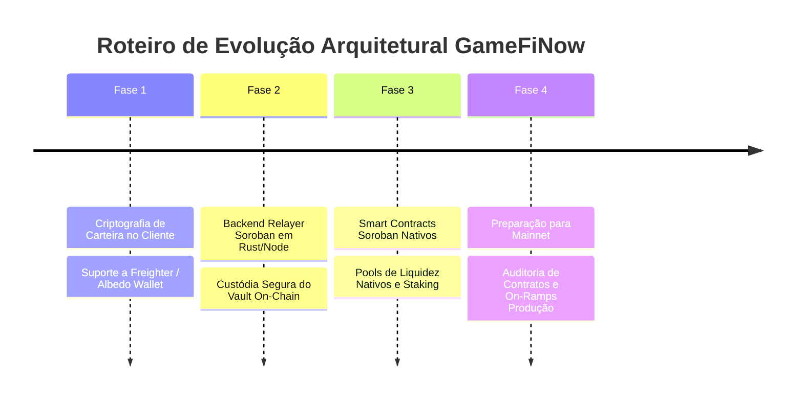

# Relatório de Auditoria Técnica e Avaliação de Arquitetura — GameFiNow

**Data:** 27 de Julho de 2026  
**Versão do Sistema:** 0.7.0 (Stellar Testnet / Soroban)  
**Ambiente:** Branch `audit/avaliacao-sistema`  
**Status do Auditor:** Arquiteto de Software Sênior & Especialista Web3/Stellar  

---

##  EXECUTIVE SUMMARY

O **GameFiNow** representa uma inovação notável na interseção entre MMOs retro pixel-art e Finanças Descentralizadas (DeFi) na blockchain **Stellar**. O sistema transforma conceitos complexos de Web3 (geração de chaves Ed25519, trustlines, swaps DEX, ancoragem fiduciária SEP-24, staking em cofres Soroban e comércio P2P) em mecânicas divertidas de gameplay.

Esta auditoria analisa a fundo toda a base de código do projeto, avaliando **segurança, arquitetura, integração com Soroban/Horizon, concorrência no multiplayer, usabilidade e viabilidade de produção (Mainnet)**.

---

## 1. INVENTÁRIO DE CONTRATOS, PROTOCOLOS E INTEGRAÇÕES

### 1.1. Ativos On-Chain (Stellar Asset Standard)
| Ativo | Emissor (Issuer Address) | Papel no Sistema | Status On-Chain |
|---|---|---|---|
| **XLM** | *Native Stellar* | Gas de rede (stroops) + pagamento obrigatório da **GameFi Fee (0.5%)** | Native Active |
| **GAMEFI** | `GCDNJUBQSX7AJWLJACMJ7I4BC3Z47BQUTMHEICZLE6MU4KQBRYG5JY6B` | Token nativo de governança, recompensas e compras P2P | Active Testnet |
| **USDW** | `GDKZT3AXAOMMYVVG3TKFVUYDJODAIAL2ADHNJYQLK2PJQ6CE2U6KKFLQ` | Stablecoin USD provida via **WalletNow SDK** | Active Testnet |
| **BRW** | `GCJIRFZQJAO6JSYS4YFXFHLVJ6R4WWWB2VTREMRK7WXNNLMGIAXBBNC6` | Stablecoin BRL provida via **WalletNow SDK** | Active Testnet |
| **USDC** | `GBBD47IF6LWK7P7MDEVSCWR7DPUWV3NY3DTQEVFL4NAT4AQH3ZLLFLA5` | Stablecoin Circle USDC na testnet | Active Testnet |

### 1.2. Contratos Soroban e Primitivos DeFi
| Funcionalidade | ID do Contrato / Implementação | Tipo de Chamada | Avaliação Atual |
|---|---|---|---|
| **Soroswap DEX LP** | `47a53a039761...` (USDW/XLM) `e17cffd02087...` (BRW/XLM) `f132db26dc15...` (BRW/USDW) | Transação Atômica Stellar (`pathPaymentStrictSend`) | **Funcional (Simulado via Path Payment)**. O ID do contrato Soroban é mapeado, porém a execução usa `strictSend` Horizon. |
| **Cofre de Staking (Vault)** | `VAULT_ADDRESS` (`GBX...` derivado de seed fixa em `stellarServices.ts`) | Transação Atômica de Pagamento + Debit de Taxa | **Funcional On-Chain**. O vault é gerenciado por uma conta agregadora com chave derivativa determinística. |
| **On-Ramp Fiduciário (SEP-24)** | `StellarAnchorService` / `sep24Service.ts` | Simulação SEP-24 + Memo `MOCK-SEP24` | **Mock On-Chain**. Gera transação real de pagamento mínimo na testnet simulando a resposta da âncora. |
| **Loja de Roupas (Outfit Store)** | `executeOutfitPurchaseOnChain` | Pagamento atômico em XLM para a conta Tesouro (`GAMEFI_TREASURY_PUBLIC_KEY`) com Memo `BUY_<outfitId>` | **100% On-Chain**. Transação real confirmada e validada no ledger. |
| **Tesouro e Cobrança de Taxa** | `economyService.ts` | Operação atômica adicional no `TransactionBuilder` debitando 0.5% em XLM | **100% On-Chain e Atômico**. Rollback automático se a taxa ou a operação falhar. |

### 1.3. Integrações de Infraestrutura
- **Stellar Horizon Testnet**: Instância oficial `https://horizon-testnet.stellar.org`.
- **WalletNow SDK (`@walletnow/sdk`)**: Autenticação, criação de passaporte e engine de conta (`RobustAccountEngine`).
- **Supabase Realtime**: Sincronização de posições de jogadores no mapa MMO (`multiplayerService.ts`).
- **CoinGecko API**: Cotações em tempo real de XLM/USD e XLM/BRL com fallback gracioso.

---

## 2. ANÁLISE DE SEGURANÇA E VULNERABILIDADES (AUDIT FINDINGS)

### 🚨 ACHADO 1 (CRÍTICO): Chaves Privadas no `localStorage` do Navegador
- **Localização**: `src/services/stellarServices.ts`, `App.tsx`
- **Descrição**: A chave secreta (`secretKey`) da carteira gerada no onboarding é armazenada em texto plano no `localStorage` do navegador do usuário.
- **Risco**: Qualquer script malicioso injetado (XSS via dependência npm vulnerável ou extensão do navegador) pode ler o `localStorage` e drenar todos os fundos da carteira do jogador.
- **Mitigação Recomendada**:
  1. Utilizar a criptografia AES-GCM orientada a senha digitada pelo usuário antes de salvar no `localStorage`.
  2. Oferecer suporte nativo a carteiras externas estendidas (Freighter, Albedo, LOBSTR) via Kit Web3 Stellar, sem nunca manipular a `secretKey` diretamente no código frontend.

### ⚠️ ACHADO 2 (ALTO): Fallback de Assinatura pelo `VAULT_KEYPAIR` no Frontend
- **Localização**: `src/services/stellarServices.ts` (linhas 446 e 543)
- **Descrição**: O código frontend contém a seed privada estática da conta Vault (`vaultSeed = "walletnow-vault"`), permitindo que a aplicação assine saques e compras usando a chave do próprio Vault diretamente no cliente.
- **Risco**: Qualquer usuário inspecionando o pacote JavaScript no navegador pode extrair a seed privada do Vault e transferir todos os fundos depositados no Vault por todos os jogadores.
- **Mitigação Recomendada**:
  - Mover a lógica de saque do Vault e autorização de custódia para um **Backend Microservice ou Relayer Soroban**. O contrato inteligente Soroban deve controlar a custódia das chaves e autorizar saques via prova criptográfica ou controle de tempo on-chain.

### ⚠️ ACHADO 3 (MÉDIO): Validação de Saldo XLM no Frontend sem Verificação On-Chain Pre-Flight no Servidor
- **Localização**: `src/services/economyService.ts`, `stellarServices.ts`
- **Descrição**: A verificação de saldo mínimo para pagamento da taxa de 0.5% (`validateXlmBalanceForFee`) é calculada localmente com base na leitura pontual do saldo.
- **Risco**: Se a rede Stellar alterar a taxa base ou se houver flutuação de concorrência antes da submissão, a transação pode ser rejeitada pela rede por saldo insuficiente para cobrir o custo de gas (stroops) + taxa de serviço.
- **Mitigação Recomendada**:
  - Adicionar simulação prévia da transação (`server.simulateTransaction`) antes da submissão final ao ledger.

---

## 3. AVALIAÇÃO DA ARQUITETURA E DESEMPENHO

### 3.1. Pontos Fortes da Arquitetura Atual
1. **Atomicidade Estrita nas Transações**: A inclusão da operação de cobrança da taxa de 0.5% para o Tesouro dentro da mesma transação Stellar (`TransactionBuilder`) garante que a plataforma nunca entregue o serviço sem receber a taxa, nem cobre a taxa se a transação falhar (Rollback atômico).
2. **Robustness do Engine de Conta (`RobustAccountEngine`)**: Implementação de sistema de retentativa (8 tentativas com retardo progressivo de 1s) para mitigar a latência de indexação do Horizon durante o processo de Friendbot e trustlines.
3. **Internacionalização (i18n)**: Suporte completo em tempo real para 3 idiomas (PT, EN, ES) em todas as camadas de UI e modais.
4. **Experiência de Usuário (UX)**: A página About, o painel de estatísticas ao vivo e os terminais dentro do jogo fornecem feedback em tempo real com links verificáveis diretamente no Stellar Expert Explorer.

### 3.2. Oportunidades de Otimização e Refatoração
1. **Deshojamento de Contratos Soroban Nativos**:
   - Atualmente, as trocas na DEX utilizam o `pathPaymentStrictSend` do protocolo Stellar clássico.
   - **Sugestão**: Migrar para chamadas diretas de contratos Soroban compilados em Rust (usando `@stellar/stellar-sdk` e `soroban-client`), interagindo diretamente com os pools da Soroswap.
2. **Persistência Multiplayer (Supabase)**:
   - A sincronização de posições no mapa e chat MMO utiliza o Supabase Realtime broadcast.
   - **Sugestão**: Implementar *throttling* de transmissão (max 10-15 updates/segundo por cliente) para evitar saturação do websocket em salas com muitos jogadores.

---

## 4. ROTEIRO DE EVOLUÇÃO TÉCNICA (ROADMAP PROPOSTO)

---

## 5. CONCLUSÃO E RECOMENDAÇÃO

O projeto **GameFiNow** demonstra um nível de maturidade técnica expressivo na integração com a rede Stellar Testnet. As fundações de economia on-chain, transações atômicas e interface com o usuário estão estabelecidas com sucesso.

Resolvendo as recomendações de segurança descritas nesta auditoria (especialmente a remoção de seeds privadas do código frontend), o sistema estará completamente pronto para escalar e avançar rumo à produção na **Mainnet da Stellar**.
