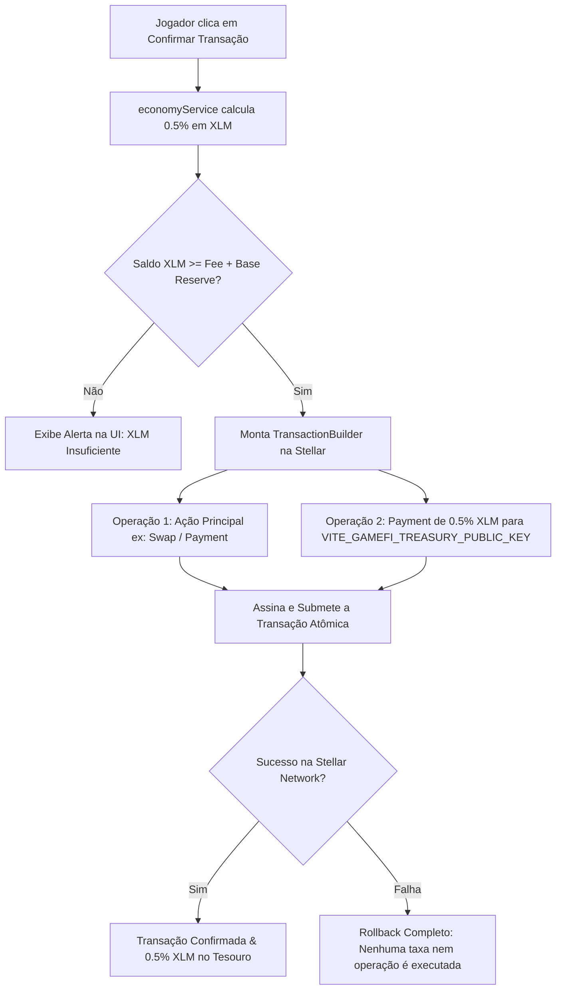

# Especificação Técnica e Tokenomics: Economia GameFiNow (Stellar Testnet)

## 1. Visão Geral
Este documento especifica a arquitetura da economia in-game do **GameFiNow**, os princípios de tokenomics, o fluxo de transações atômicas na rede Stellar e a cobrança da taxa de serviço da plataforma (GameFi Fee).

O objetivo principal é criar um ecossistema sustentável, transparente e atrativo para os jogadores, garantindo que todas as operações financeiras realizadas dentro do jogo (On-ramp no Norte da ilha, swaps DEX, depósitos, saques e transferências P2P) contribuam ativamente para o tesouro e para o mecanismo deflacionário do token nativo da plataforma.

---

## 2. Tokenomics e Estrutura de Ativos

### 2.1. Matriz de Ativos da Ilha

| Ativo | Tipo | Descrição | Emissor (Issuer) / Endereço |
|---|---|---|---|
| **XLM** | Nativo Stellar | Moeda base da rede. Utilizada para cobrir *gas fees* on-chain e pagamento obrigatório da **GameFi Fee (0.5%)**. | *Native Stellar Asset* |
| **USDW** | Asset Customizado | Stablecoin atrelada ao Dólar (USD) para precificação de itens e trocas. | `ISSUER_USDW` (`GDKZT...`) |
| **BRW** | Asset Customizado | Stablecoin atrelada ao Real Brasileiro (BRL) para trocas fiduciárias regionais. | `ISSUER_BRW` (`GCJIR...`) |
| **SRT** | Asset Customizado | Stellar Resource Token, ganho em quests, eventos e exploração na ilha. | `ISSUER_SRT` (`GCDNJ...`) |
| **GAMEFI** | Asset Customizado | Token nativo de governança, utilidade e recompensas do ecossistema GameFiNow. | `ISSUER_GAMEFI` (`VITE_GAMEFI_TOKEN_ISSUER`) |

---

## 3. Modelo de Cobrança da Taxa (GameFi Fee: 0.5% em XLM)

### 3.1. Regra de Negócio
- **Alíquota**: **0.5%** (0.005) sobre o valor total bruto de cada transação originada na wallet do jogo.
- **Moeda de Pagamento**: **XLM (Stellar Lumens nativo)** obrigatoriamente.
- **Estratégia de Cobrança (Opção A - Saldo Direto)**:
  - O jogador deve possuir um saldo suficiente de XLM nativo na carteira para debitar a taxa de 0.5% correspondente.
  - Caso o saldo em XLM seja inferior à taxa calculada + reserva de base Stellar (1.5 XLM), a transação é bloqueada no frontend com aviso claro ao usuário.

### 3.2. Operações Impactadas
1. **On-Ramp no Norte da Ilha (SEP-24)**: Compra de tokens fiduciários (USDW/BRW).
2. **Swaps na DEX Stellar**: Trocas de qualquer par (ex: USDW <-> BRW, XLM <-> SRT).
3. **Depósitos e Saques Externos**: Transferências de/para carteiras externas.
4. **Transferências P2P**: Trocas entre jogadores dentro do mapa.

## 4. Oferta, Emissão e Queima (Burn) de GAMEFI

Para manter o token nativo balanceado, o ecossistema implementa duas estruturas físicas centrais exclusivas para jogadores com a **Estrela de Guardião**:

### 4.1. Fonte Mágica (Faucet Diário)
- **Mecânica de Emissão**: Os jogadores qualificados podem se aproximar da Fonte (Magic Faucet) uma vez a cada 24 horas.
- **Recompensa**: Emissão direta de **10 GAMEFI** por dia. Esta é a única fonte primária de introdução de novos tokens em circulação fora de eventos especiais.

### 4.2. Mercado P2P (P2P Store)
- **Mecânica de Circulação**: Um terminal no jogo que permite a listagem de itens e troca direta entre os jogadores. A moeda base para essas transações é o GAMEFI, aumentando a velocidade da moeda (velocity of money) e sua utilidade.

### 4.3. Altar de Queima Eterna (Burn Altar)
- **Mecânica Deflacionária**: Jogadores podem ir ao Altar de Queima e sacrificar (queimar) voluntariamente tokens GAMEFI.
- **Impacto On-Chain**: Estes tokens são enviados para um endereço irrecuperável na Stellar. Essa mecânica ajuda a combater a inflação gerada pela Faucet, mantendo a estabilidade da economia.

---

## 5. Garantia de Atomicidade On-Chain (Stellar Operations)

Todas as transações que envolvem a GameFi Fee utilizam o recurso nativo da Stellar de **operações atômicas** dentro de um mesmo `TransactionBuilder`.



---

## 5. Estrutura do Tesouro & Buyback & Burn de GAMEFI

### 5.1. Distribuição das Fees Coletadas (0.5% XLM)

Todo o montante acumulado na conta do **GameFi Treasury** (`VITE_GAMEFI_TREASURY_PUBLIC_KEY`) é dividido e aplicado seguindo a proporção:

```
                          [ Taxas Coletadas em XLM ]
                                       │
                ┌──────────────────────┼──────────────────────┐
                ▼                      ▼                      ▼
        [ 70% Tesouro ]         [ 20% Staking ]       [ 10% Buyback & Burn ]
     Fundo de Reserva da      Pools de Liquidez e     Compra de token GAMEFI
        Ilha e Infra          Recompensas de Play      na DEX Stellar + Envio
                                   -to-Earn           para Endereço Nulo (Burn)
```

1. **70% - Fundo de Reserva do Tesouro**: Manutenção da infraestrutura da ilha, custos da rede Testnet/Mainnet e expansão.
2. **20% - Pool de Staking e Recompensas**: Distribuído para jogadores que realizam staking de tokens ou cumprem objetivos no jogo.
3. **10% - Buyback & Burn Imediato/Assíncrono**:
   - A conta do Tesouro executa a compra de tokens `GAMEFI` na DEX da Stellar usando o saldo de XLM reservado.
   - Os tokens `GAMEFI` comprados são enviados para um endereço nulo inativo (`G...BURN`), reduzindo a oferta circulante e criando pressão compradora direta no mercado.

---

## 6. Arquitetura de Software e Configuração de Ambientes

### 6.1. Arquivos de Configuração por Ambiente

Em atendimento às boas práticas de segurança e gerenciamento de segredos:

- **`.env-dev`**: Ambiente de Desenvolvimento / Testnet.
- **`.env-homolog`**: Ambiente de Homologação / Staging.
- **`.env-prod`**: Ambiente de Produção / Mainnet.

#### Variáveis Padrão:
```ini
VITE_STELLAR_NETWORK=testnet
VITE_HORIZON_URL=https://horizon-testnet.stellar.org
VITE_GAMEFI_TREASURY_PUBLIC_KEY=G...TREASURY
VITE_GAMEFI_TOKEN_CODE=GAMEFI
VITE_GAMEFI_TOKEN_ISSUER=G...ISSUER
VITE_GAMEFI_FEE_PERCENTAGE=0.005
```

### 6.2. Módulos do Sistema

1. **`src/services/economyService.ts`**:
   - `calculateGameFiFee(amountInXlm: number): number`
   - `estimateFeeInXlm(assetCode: string, amount: number, xlmRate: number): number`
   - `validateXlmFeeBalance(userPublicKey: string, requiredFeeXlm: number): Promise<{ isValid: boolean; currentXlm: number }>`
2. **`src/services/stellarServices.ts`**:
   - Atualizado para anexar automaticamente a operação de pagamento da taxa para o `VITE_GAMEFI_TREASURY_PUBLIC_KEY` em cada transação enviada à rede Stellar.
   - Suporte para inicialização de trustlines do token `GAMEFI` **imediatamente na criação da conta (Forja da Chave no Mapa Leste)**, garantindo que a carteira esteja pronta para receber as recompensas da Faucet.
3. **`src/components/` (Modais de Transação)**:
   - Exibição transparente da discriminação dos valores na UI (Valor bruto, Taxa GameFi 0.5% XLM, Taxa Horizon de Rede, Valor Líquido).

---

## 7. Critérios Técnicos de Sucesso & Validação

- [x] Branch dedicada `feature/economia-tokenomics` criada.
- [x] Documento de especificação técnica gerado e integrado.
- [x] Arquivos `.env-dev`, `.env-homolog`, `.env-prod` parametrizados.
- [x] `economyService.ts` implementado com testes de validação de saldo e cálculo de fees.
- [x] Operações atômicas de 0.5% XLM integradas em `stellarServices.ts`.
- [x] Interface gráfica exibindo taxas de forma 100% transparente para o usuário antes da confirmação.
- [x] Faucet Diário e Trustlines iniciais implementadas e testadas.
- [x] Fluxo validado e executado sem erros na Stellar Testnet.
