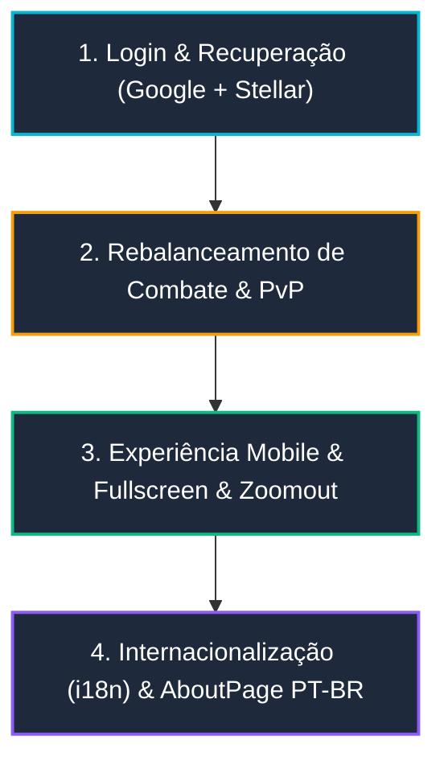

# 📋 GameFiNow — Plano de Execução do Backlog & Refinamentos

> **Branch Ativa:** `feat/backlog-refinements-and-fixes`  
> **Status:** Planejamento Aprovado para Execução Semanal (1 frente por vez)  
> **Diretriz de Qualidade:** Cada frente possui objetivos claros, arquivos de impacto mapeados, estratégia de testes e critérios de aceite antes de avançar para a próxima.

---

## 🎯 Visão Geral dos 4 Pilares do Backlog

---

## 🚀 FASE 1: Login, Google Auth & Recuperação de Conta Simplificada
> **Prioridade:** 🔴 P0 (Crítica / Bloqueante)  
> **Objetivo:** Acabar com o atrito de OTP mockado e digitação de Secret Keys para usuários casuais, oferecendo login e recuperação em 1 clique via Google OAuth do Supabase, **sem quebrar** a criação de carteira Ed25519 e transações on-chain Stellar.

### Diagnóstico Técnico Atual
- `AccountRecoveryModal.tsx`: O fluxo de e-mail OTP é um mock que valida `"123456"`.
- A restauração manual exige a Secret Key Stellar (`S...`), gerando perda frequente de contas no mobile/limpeza de cache.
- O endpoint `/api/auth/token` no backend já gera JWT assinado para o Supabase usando o `publicKey`.

### Tarefas Detalhadas (Tasks)
- [ ] **Task 1.1 — Schema Supabase:** Garantir suporte a `google_uid` e `email` indexados na tabela `players` para vínculo atômico `google_uid ↔ stellar_address`.
- [ ] **Task 1.2 — Serviço de Auth Unificado (`src/services/authService.ts`):** Criar cliente para `supabase.auth.signInWithOAuth({ provider: 'google' })`, com handlers para detecção de perfil existente ou primeiro acesso.
- [ ] **Task 1.3 — Tela de Login (`LoginScreen.tsx`):**
  - Adicionar botão retro-moderno **"Entrar com Google"** com destaque visual no painel direito.
  - Manter opção "Jogar como Convidado" (Frictionless) e atalho de restauração via Google.
- [ ] **Task 1.4 — Modal da Forja de Carteira (`GameOverlay.tsx` › `WalletForgeModal`):**
  - Inserir botão **"Conectar com Google"** no Terminal East, permitindo atrelar o herói ao e-mail/Google com 1 clique e salvando o backup de identidade.
- [ ] **Task 1.5 — Modal de Recuperação (`AccountRecoveryModal.tsx`):**
  - Substituir a aba de OTP fictício pela restauração em 1 clique via Google ("Recuperar com Google").
  - Preservar a aba "Secret Key (SEP-10)" como plano de contingência e emergência para usuários puristas Web3.
- [ ] **Task 1.6 — Garantia On-Chain:**
  - Garantir que o `onboardUser` gere o par de chaves Stellar, chame o Friendbot e crie as Trustlines (USDW, BRW, GAMEFI) normalmente, associando a chave gerada ao perfil Google recém-criado.

### Testes da Fase 1
- `AUTH-01`: Primeiro login Google provisiona chave on-chain e trustlines sem erros.
- `AUTH-02`: Limpeza de cache + login com Google restaura nível, saldo e inventário.
- `AUTH-03`: Fallback manual com Secret Key continua restaurando a conta com precisão.

---

## ⚔️ FASE 2: Rebalanceamento Matemático de Combate (PvP & PvE)
> **Prioridade:** 🔴 P0 (Crítica / Gameplay)  
> **Objetivo:** Corrigir os danos físicos que atualmente são genéricos/idênticos entre armas e classes, e eliminar o "one-shot-kill" de magias, criando um combate tático com base em Level, Atributos de Classe (STR, AGI, INT, VIT), Equipamento e Defesa.

### Diagnóstico Técnico Atual
- Em `server.ts` e `pvpEngine.ts`, o dano físico usa `(attacker.attack || 10) * (1 + strBonus / 100) - target.defense / 2`. Como a maioria dos jogadores entra sem armas ou com armas que só aplicam multiplicadores simples, o dano físico básico fica idêntico (~8 a 12 de dano), independente da classe ou nível.
- O dano mágico usa `spellPower * (1 + intValue / 80)`. Magias com `basePower = 120` atingem mais de 180 de dano em alvos com 100 de HP, causando **morte imediata em 1 golpe**.
- A arma equipada na mão direita (`equippedItems.rightHand`) e armaduras não estão sendo totalmente consideradas no payload de combate do servidor.

### Tarefas Detalhadas (Tasks)
- [ ] **Task 2.1 — Inclusão de Armas e Escudos no Payload do Servidor:**
  - Enviar e validar no backend (`server.ts`) as armas equipadas (`rightHand`, `leftHand`) e seus bônus reais do catálogo `EQUIPMENT_CATALOG`.
- [ ] **Task 2.2 — Diferenciação de Dano Físico por Classe e Nível:**
  - **Warrior / Guardian:** Fator de escala em Força (STR) e bônus de arma pesada. Dano físico consistente e chance de atordoamento/slow.
  - **Cosmic Ranger:** Fator de escala em Agilidade (AGI), alcance estendido (range = 4) e alta taxa de acerto crítico.
  - **Soroban Mage:** Dano físico base baixo, forçando o uso de cajados e magias para ser efetivo.
  - **Fórmula de Nível:** Incorporar `attacker.level` e `target.level` no cálculo do escalonamento de dano físico e defesa.
- [ ] **Task 2.3 — Fim do One-Shot Kill em Magias:**
  - Reduzir `basePower` das magias de dano direto para faixas saudáveis (ex: magias básicas consom 20-35% do HP do rival, magias supremas no máximo 45-55%).
  - Criar mitigação mágica: atributos de Sabedoria/Fé (VIT/WIS) do alvo reduzem o dano recebido.
  - Adicionar tempo de recarga tático e custo proporcional de Mana (MP) para punir spam descuidado.
- [ ] **Task 2.4 — Sincronização entre `pvpEngine.ts` e `server.ts`:**
  - Eliminar duplicações de lógica: o motor matemático de `pvpEngine.ts` deve ser a única fonte de cálculo utilizada tanto no backend quanto no frontend.

### Testes da Fase 2
- `PVP-01`: Duelo entre Guerreiro armado vs Mago sem arma tem diferença expressiva de dano físico.
- `PVP-02`: Nenhuma magia de nível equivalente consegue abater um jogador full HP em 1 único ataque.
- `PVP-03`: Alvo com escudo equipado (`leftHand`) absorve a porcentagem correta de DEF.

---

## 📱 FASE 3: Otimização Mobile, Fullscreen, Orientação Landscape & Câmera (Zoomout)
> **Prioridade:** 🟠 P1 (Alta / Usabilidade)  
> **Objetivo:** Proporcionar uma experiência mobile de jogo profissional: suporte a tela cheia horizontal (Landscape), botões de batalha centrais e ergonômicos para os polegares, e ajuste de zoomout na câmera para visualização ampla do mapa e dos adversários.

### Diagnóstico Técnico Atual
- No [GameCanvas.tsx](file:///c:/Users/Usuário/Documents/GitHub/gamefinow_game/src/components/GameCanvas.tsx#L2248), a câmera mobile aplica zoom `2.5` enquanto desktop aplica `3.5`. O boneco fica muito próximo da tela no celular, limitando a visão periférica de monstros e portais.
- A rotação de tela para horizontal (Landscape) quebra o scroll e as alturas de viewport (`100vh` vs `100dvh`).
- Os botões de combate no [BattleHUD.tsx](file:///c:/Users/Usuário/Documents/GitHub/gamefinow_game/src/components/BattleHUD.tsx) ficam na barra inferior horizontal, competindo com barras nativas do Android/iOS e distantes da pegada ergonômica dos polegares (botões de ação na direita e joystick na esquerda).

### Tarefas Detalhadas (Tasks)
- [ ] **Task 3.1 — Zoomout da Câmera no Mobile:**
  - Reduzir o zoom padrão mobile de `2.5` para `1.8` - `2.0` (visão mais distante, permitindo antecipar inimigos e ter maior noção espacial).
  - Adicionar controle de pinça (pinch-to-zoom) ou botão rápido no HUD para o jogador alternar entre visão tática (zoomout) e visão detalhada (zoom in).
- [ ] **Task 3.2 — Suporte e Bloqueio de Orientação Landscape:**
  - Configurar CSS e meta-tags com `100dvh` (Dynamic Viewport Height) para evitar pulos quando a barra do navegador recolhe.
  - Adicionar aviso suave ou trava convidativa: *"Gire seu aparelho na horizontal para melhor experiência de batalha"* quando aberto em retrato (Portrait).
  - Implementar API Fullscreen nativa (`element.requestFullscreen()`) com botão de atalho no HUD mobile.
- [ ] **Task 3.3 — Reorganização Ergonômica dos Controles de Batalha:**
  - Layout clássico de controle arcade/RPG mobile:
    - **Polegar Esquerdo:** Joystick virtual (`nipplejs`) para movimento fluido.
    - **Polegar Direito:** Botões de ação em arco (Ataque Físico grande central, 3 Spells em semicírculo e poções acima).
  - Aumentar área de toque (touch target ≥ 48px) com feedback háptico/sonoro imediato.
- [ ] **Task 3.4 — Otimização de Performance Canvas no Celular:**
  - Limitar FPS em telas de 60Hz/120Hz sem superaquecer a bateria do aparelho móvel.

### Testes da Fase 3
- `MOB-01`: Rotação vertical/horizontal não quebra canvas nem esconde botões.
- `MOB-02`: Botões de batalha respondem simultaneamente ao toque do joystick sem conflito multitoque (multi-touch test).
- `MOB-03`: Câmera com zoomout exibe no mínimo 12x8 tiles ao redor do herói em telas móveis padrão (390x844px).

---

## 🌐 FASE 4: Revisão Completa de Idiomas (PT-BR), i18n & AboutPage
> **Prioridade:** 🟡 P2 (Refinamento e Polimento)  
> **Objetivo:** Garantir uma localização impecável em Português do Brasil (PT-BR), com termos coesos do universo gamer, tradução total da [AboutPage.tsx](file:///c:/Users/Usuário/Documents/GitHub/gamefinow_game/src/components/AboutPage.tsx) e ausência de chaves cruas ou textos em inglês no ecossistema PT.

### Diagnóstico Técnico Atual
- [AboutPage.tsx](file:///c:/Users/Usuário/Documents/GitHub/gamefinow_game/src/components/AboutPage.tsx) possui strings hardcoded em inglês misturadas com português (ex: textos de Horizon, descrições técnicas de Smart Contracts).
- Arquivos de tradução em `src/i18n/locales/` (`pt.json`, `en.json`, `es.json`) possuem pequenas discrepâncias de chaves e termos técnicos da rede Stellar que carecem de padronização em PT-BR.

### Tarefas Detalhadas (Tasks)
- [ ] **Task 4.1 — Auditoria e Extração de Textos da `AboutPage.tsx`:**
  - Mapear todas as seções (Arquitetura, Tokenomics, Testnet, Smart Contracts Soroban, Roadmap) para o arquivo de i18n sob a chave `about.*`.
  - Garantir linguagem natural, profissional e envolvente em PT-BR.
- [ ] **Task 4.2 — Varredura Completa do Dicionário `pt.json`:**
  - Corrigir termos e mensagens de erro do sistema, diálogos de NPCs e notificações de combate.
  - Eliminar qualquer texto residual em inglês quando o idioma ativo for `pt-BR`.
- [ ] **Task 4.3 — Sincronização entre `pt.json`, `en.json` e `es.json`:**
  - Garantir paridade 1:1 de chaves entre todos os arquivos de idioma para que trocar para EN ou ES nunca resulte em `undefined` ou chave crua exibida em tela.

### Testes da Fase 4
- `I18N-01`: Varredura automatizada confirma 0 chaves faltantes entre `pt.json`, `en.json` e `es.json`.
- `I18N-02`: Acessar todas as abas da AboutPage em PT-BR valida que 100% dos blocos estão no idioma correto.

---

## 📅 Cronograma Semanal Sugerido

| Dia / Etapa | Foco de Entrega | Entregáveis Principais |
|---|---|---|
| **Dia 1 & 2** | **Fase 1: Login & Google Auth** | Google OAuth no Supabase, criação/link de wallet e recuperação em 1 clique |
| **Dia 3** | **Fase 2: Rebalanceamento PvP** | Fórmulas de dano físico por classe/nível e fim do one-shot kill de magias |
| **Dia 4** | **Fase 3: Experiência Mobile** | Zoomout de câmera, tela cheia landscape e controles ergonômicos no polegar |
| **Dia 5** | **Fase 4: i18n & AboutPage** | Tradução impecável da AboutPage e sincronização total dos locales PT-BR |
| **Dia 6** | **Execução da Suíte de Testes** | Rodar toda a bateria automatizada de testes cobrindo as 4 frentes |

---

> [!TIP]
> Todas as mudanças serão desenvolvidas e testadas dentro da branch isolada **`feat/backlog-refinements-and-fixes`**, garantindo total integridade da branch `main`.
