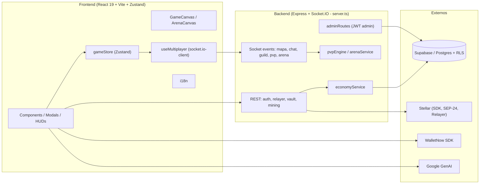
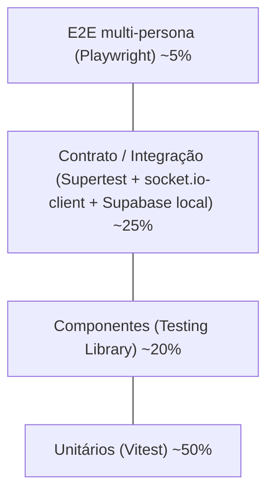
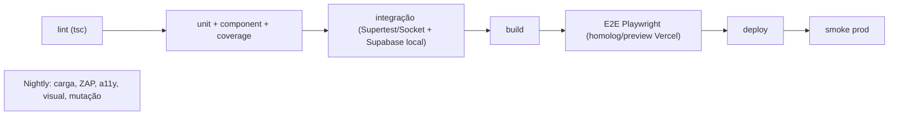

# 🧪 GameFiNow — Plano Mestre da Suíte de Testes

> **Versão:** 1.0 · **Projeto:** `gamefinow` v1.5.0-pvp · **Status:** Planejamento (nenhum teste novo foi implementado ainda)
> **Objetivo:** Definir **o que** testar, **como** testar, **com quais personas** e **em que ordem**, cobrindo tudo o que está ao nosso alcance hoje e no futuro.

---

## 0. Sumário

1. [Contexto e mapa do sistema](#1-contexto-e-mapa-do-sistema)
2. [Estado atual dos testes](#2-estado-atual-dos-testes)
3. [Estratégia (pirâmide e camadas)](#3-estratégia-pirâmide-e-camadas)
4. [Ferramentas recomendadas](#4-ferramentas-recomendadas)
5. [Estrutura de diretórios e convenções](#5-estrutura-de-diretórios-e-convenções)
6. [Personas de teste](#6-personas-de-teste)
7. [Catálogo de testes por domínio](#7-catálogo-de-testes-por-domínio)
8. [Jornadas E2E por persona](#8-jornadas-e2e-por-persona)
9. [Testes não funcionais](#9-testes-não-funcionais)
10. [Dados, fixtures e mocks](#10-dados-fixtures-e-mocks)
11. [Ambientes e CI/CD](#11-ambientes-e-cicd)
12. [Métricas, critérios de aceite e gates](#12-métricas-critérios-de-aceite-e-gates)
13. [Roadmap de implementação](#13-roadmap-de-implementação)
14. [Riscos e mitigação](#14-riscos-e-mitigação)
15. [Backlog de testes futuros](#15-backlog-de-testes-futuros)

**Legenda de prioridade:** 🔴 P0 (bloqueante/crítico) · 🟠 P1 (alto) · 🟡 P2 (médio) · 🟢 P3 (desejável/futuro)

---

## 1. Contexto e mapa do sistema



### Superfície testável identificada

| Camada | Itens |
|---|---|
| **Dados estáticos** | `classesData`, `spellsData`, `equipmentData`, `guildsData`, `gameData`, `maps/*`, `outfitsRegistry`, `titlesRegistry`, `i18n` |
| **Lógica pura** | `pvp/pvpEngine`, `pvp/arenaMap`, `utils/cryptoUtils`, `utils/profanityFilter`, `utils/audioUtils` |
| **Estado** | `store/gameStore` (≈40 actions: XP, quests, spells, poções, equipamentos, buffs, morte/respawn, arena score) |
| **Serviços** | `arenaService`, `economyService`, `multiplayerService`, `stellarServices`, `sep24Service`, `supabaseClient`, `audioStreamService` |
| **REST** | `POST /api/auth/token`, `/api/relayer/submit`, `/api/vault/withdraw`, `/api/mining/start`, `/api/mining/collect` |
| **Admin REST** | `POST /login`, `GET /users`, `POST /users/:id/ban|unban`, `POST /ban`, `POST /suspend`, `GET /logs`, `GET /metrics`, `GET /economy`, `GET|POST /panic` |
| **Socket.IO** | `join_map`, `player_move`, `chat_message`, `chat_global_message`, `join_guild`, `guild_chat_message`, `pvp_attack`, `pvp_cast_spell`, `arena_join_request`, `arena_move`, `arena_attack`, `arena_cast_spell`, `arena_leave`, `disconnect` |
| **UI** | 26 componentes (Login, Landing, ClassSelection, Customizer, Arena*, Battle/HUDs, Chat, Guild, Shop, Passport, Admin, DeathScreen, Tutorial…) |
| **Banco** | `supabase_migration_v1/v2.sql`, `supabase_rls_setup.sql` |

---

## 2. Estado atual dos testes

| Arquivo | Tipo | Cobre |
|---|---|---|
| `src/classesData.test.ts` | Unit | Integridade das classes |
| `src/spellsData.test.ts` | Unit | Integridade das magias |
| `src/guildsData.test.ts` | Unit | Guildas |
| `src/maps/mapsIntegrity.test.ts` | Unit | Integridade dos mapas |
| `src/pvp/pvpEngine.test.ts` | Unit | Motor de PvP |
| `src/pvp/arenaPvP.test.ts` | Unit/Integração | Arena |
| `src/store/gameStore.test.ts` / `.qa.test.ts` | Unit | Store |
| `scripts/pvpLoadBenchmark.ts` | Carga | Benchmark PvP |
| `test_arena.cjs`, `test_jwt.ts`, `test_relayer.ts` (raiz) | Scripts manuais | Arena / JWT / Relayer |

**Lacunas principais:** REST e Admin sem testes automatizados · Socket.IO sem testes de contrato · zero testes de componentes React · zero E2E · sem cobertura medida · sem testes de RLS · scripts soltos na raiz fora do Vitest.

---

## 3. Estratégia (pirâmide e camadas)



| Camada | Objetivo | Velocidade | Roda em |
|---|---|---|---|
| **Unit** | Regras puras, dados, store | ms | Todo commit |
| **Componentes** | Renderização, interação, acessibilidade | <1s | Todo commit |
| **Integração/Contrato** | REST, Socket, DB, serviços com mocks de borda | s | Todo PR |
| **E2E** | Jornadas reais por persona, multi-browser/multi-cliente | min | PR para `main` + nightly |
| **Não funcionais** | Carga, segurança, a11y, visual, caos | min–h | Nightly / pré-release |

**Princípios:** determinismo (seed de RNG e relógio falso), isolamento (sem rede real por padrão), testes como documentação (nome em pt-BR descrevendo comportamento), cada bug corrigido → teste de regressão.

---

## 4. Ferramentas recomendadas

| Necessidade | Ferramenta | Justificativa |
|---|---|---|
| Runner unit/integração | **Vitest** (já instalado) | Nativo Vite/TS |
| Cobertura | `@vitest/coverage-v8` | Zero config |
| Componentes | `@testing-library/react`, `@testing-library/user-event`, `jsdom` | Padrão de mercado |
| Canvas | `vitest-canvas-mock` | Evitar crash em `getContext` |
| HTTP | `supertest` | Testar Express sem porta |
| WebSocket | `socket.io-client` (já instalado) | Clientes reais contra servidor em memória |
| Mocks de rede | `msw` | Mock de Supabase/Stellar/GenAI no browser e Node |
| Banco | **Supabase CLI local** (Docker) | Testar migrations e RLS de verdade |
| Stellar | **Testnet / Friendbot** ou `stellar/quickstart` (Docker) | Transações reais sem custo |
| E2E | **Playwright** | Multi-contexto (vários jogadores no mesmo teste), traces, vídeo |
| Carga | `scripts/pvpLoadBenchmark.ts` + **k6** / **Artillery (socket.io engine)** | Socket em escala |
| Segurança | `npm audit`, **OWASP ZAP** baseline, `gitleaks` | SAST/DAST/segredos |
| A11y | `@axe-core/playwright`, `vitest-axe` | WCAG |
| Visual | Playwright `toHaveScreenshot` | Regressão de HUD/Canvas |
| Property-based | `fast-check` | Fórmulas de dano/economia |
| Mutação | `Stryker` | Qualidade dos testes do pvpEngine/economia |

---

## 5. Estrutura de diretórios e convenções

```
tests/
├── setup/                 # vitest.setup.ts, canvas mock, msw server, fake timers
├── fixtures/              # personas.ts, players.ts, wallets.ts, sessions.ts
├── factories/             # buildPlayer(), buildArenaSession(), buildSpell()...
├── mocks/                 # handlers msw: supabase, stellar, walletnow, genai
├── unit/                  # (ou co-localizado *.test.ts ao lado do código – padrão atual)
├── component/             # *.component.test.tsx
├── integration/
│   ├── rest/              # auth, relayer, vault, mining, admin
│   ├── socket/            # map, chat, guild, pvp, arena
│   └── db/                # migrations, RLS
├── e2e/
│   ├── personas/          # jornadas por persona
│   └── multiplayer/       # cenários com N contextos
├── load/                  # k6 / artillery
└── security/              # payloads XSS/injeção, ZAP config
```

**Convenções**
- Manter o padrão atual **co-localizado** para unit (`arquivo.test.ts`); demais camadas em `tests/`.
- Sufixos: `.test.ts` (unit), `.component.test.tsx`, `.int.test.ts`, `.e2e.spec.ts`, `.load.ts`.
- Nome: `describe('pvpEngine › cálculo de dano')` / `it('não deve aplicar dano quando alvo está em zona segura')`.
- Padrão **AAA** (Arrange/Act/Assert); um comportamento por `it`.
- Scripts `package.json` sugeridos: `test`, `test:unit`, `test:component`, `test:int`, `test:e2e`, `test:load`, `test:coverage`, `test:security`.
- Mover `test_arena.cjs`, `test_jwt.ts`, `test_relayer.ts` para `tests/integration/` e converter em Vitest.

---

## 6. Personas de teste

Cada persona vira uma **fixture** (`tests/fixtures/personas.ts`) com estado de store, carteira, permissões e comportamento esperado.

| ID | Persona | Perfil | O que estressa |
|---|---|---|---|
| **P01** | 🐣 **Novato Nina** | 1º acesso, sem carteira, mobile | Landing, onboarding, tutorial, escolha de classe, joystick (nipplejs) |
| **P02** | 🎮 **Casual Caio** | Nível 3–10, joga 15 min/dia | Quests, XP, poções, loja, mapas, level 5 intro |
| **P03** | ⚔️ **Hardcore Hugo** | Nível máximo, build otimizada | Combos de spell, cooldown, mana, buffs, equipamentos, limites de stats |
| **P04** | 🏟️ **PvP Paula** | Competitiva, vive na Arena | Matchmaking, `arena_*`, placar, morte/respawn, latência |
| **P05** | 🛡️ **Líder de Guilda Gui** | Gerencia guilda | `join_guild`, chat de guilda, GuildHouse |
| **P06** | 💰 **Investidor Ivo** | Foco em economia/Web3 | Mining start/collect, vault withdraw, relayer, SEP-24, Stellar, WalletNow |
| **P07** | 🗣️ **Social Sofia** | Chat intenso, multi-idioma | Chat mapa/global, profanity filter, i18n, emojis, RTL |
| **P08** | 🧑‍⚖️ **Admin Ana** | Moderadora | Login admin, ban/unban, suspend, logs, metrics, economy, **panic** |
| **P09** | 🦹 **Trapaceiro Tito** | Atacante/cheater | Speed hack, teleporte, dano forjado, replay, spam de socket, JWT forjado, XSS, injeção, double-spend |
| **P10** | 📶 **Instável Ícaro** | Rede 3G, quedas | Reconexão, `disconnect`, estado órfão na arena, timeouts/retry |
| **P11** | ♿ **Acessível Alice** | Leitor de tela, só teclado, daltônica | a11y, contraste, foco, ARIA |
| **P12** | 🔁 **Recuperador Rui** | Perdeu acesso ao dispositivo | Restauração de conta via Google Auth (recupera vínculo com chave pública Stellar) e fallback Secret Key |
| **P13** | 🚫 **Banido Bruno** | Conta banida/suspensa | Bloqueio de login, socket recusado, unban restaura acesso |
| **P14** | 🤖 **Bot de Carga** | N clientes sintéticos | Throughput, memória do servidor, broadcast |
| **P15** | 🎨 **Fashionista Fê** | Cosméticos | OutfitShop, CharacterCustomizer, titles |
| **P16** | 🌐 **Google Gabriel** | Login moderno em 1 clique | Autenticação via Google OAuth/Supabase, criação imediata/automática de Stellar Keypair atrelada ao UID Google, recuperação instantânea em novo device |

---

## 7. Catálogo de testes por domínio

> Formato: **ID · Cenário · Tipo · Persona · Prioridade**. "Possível/futuro" marcado com ⏭️.

### 7.1 Dados estáticos e integridade
| ID | Cenário | Tipo | Prio |
|---|---|---|---|
| DATA-01 | Toda classe tem stats base válidos (>0), spells existentes e únicas | Unit | 🔴 |
| DATA-02 | Toda spell: id único, custo de mana ≥0, cooldown ≥0, elemento válido, nível requerido coerente | Unit | 🔴 |
| DATA-03 | Equipamentos: preço >0, slot válido, sem ids duplicados | Unit | 🟠 |
| DATA-04 | Mapas: dimensões consistentes, spawn em tile caminhável, portais apontam para mapas existentes e bidirecionais | Unit | 🔴 |
| DATA-05 | Toda NPC/quest referencia mapa/criatura existente; grafo de quests sem ciclos | Unit | 🟠 |
| DATA-06 | Outfits/titles: ids únicos, assets existentes em `public/`/`assets/` | Unit | 🟡 |
| DATA-07 | i18n: todas as chaves presentes em todos os idiomas; sem interpolação quebrada | Unit | 🟠 |
| DATA-08 ⏭️ | Snapshot do balanceamento (detecta mudança não intencional) | Unit | 🟡 |

### 7.1.1 Autenticação, Google Auth, Carteira e Recuperação (Novo Núcleo Crítico)
| ID | Cenário | Tipo | Persona | Prio |
|---|---|---|---|---|
| AUTH-01 | **Login Google 1º Acesso**: Login via Supabase OAuth `signInWithOAuth({ provider: 'google' })` → se usuário não possui Stellar Address registrado na tabela `players`, gera Keypair Stellar Ed25519, provisiona on-chain (Friendbot/Testnet), cria trustlines e salva vínculo `google_uid ↔ stellar_address` | Integração / E2E | P16 | 🔴 |
| AUTH-02 | **Recuperação Automática Google**: Usuário em novo dispositivo/após limpar cache clica em "Entrar com Google" → localiza perfil existente na tabela `players` pelo `google_uid`/`email` → restaura dados, inventário, nível, `stellar_address` sem recriar chave | Integração / E2E | P12, P16 | 🔴 |
| AUTH-03 | **Preservação On-Chain**: A integração Google Auth NÃO substitui a carteira Stellar: as operações de Smart Contract (Soroban), Trustlines e Assinatura continuam usando Ed25519 nativo | Contrato / Unit | P06, P16 | 🔴 |
| AUTH-04 | **Modo Convidado / Anônimo para Google**: Usuário entra anonimamente (Frictionless), joga, e no modal de Wallet clica em "Conectar Google" → vincula conta Google ao endereço Stellar gerado sem perda de XP ou progresso | Componente / Int | P01, P16 | 🔴 |
| AUTH-05 | **Recuperação de Emergência (Secret Key)**: Se o provedor Google falhar ou o usuário desejar importar via chave bruta, o modo `Secret Key` (SEP-10 fallback) continua 100% funcional | Unit / Componente | P12 | 🔴 |
| AUTH-06 | **Token Backend Exchange**: Supabase Session JWT trocado ou validado pelo backend Express `/api/auth/token` garantindo que o `stellar_address` seja autenticado na RLS | Integração | P16 | 🔴 |
| AUTH-07 | **Cancelamento/Erro Google OAuth**: Usuário fecha popup do Google ou nega permissão → aplicação trata de forma graciosa sem travar a tela ou corromper a store | Componente | P16 | 🟠 |
| AUTH-08 | **Migração de Contas Legadas**: Usuário que já tinha conta e-mail OTP/Secret Key consegue vincular sua conta Google | Integração | P02, P16 | 🟠 |

### 7.2 Store (`gameStore`)
| ID | Cenário | Prio |
|---|---|---|
| ST-01 | `addExperience` sobe nível no limiar exato, múltiplos níveis de uma vez, não ultrapassa nível máximo | 🔴 |
| ST-02 | `registerKill` atualiza progresso de quest somente no mapa correto | 🔴 |
| ST-03 | `completeQuest` idempotente (não paga recompensa 2x) | 🔴 |
| ST-04 | `castSpell` / `castSpellSlot`: bloqueia sem mana, respeita cooldown (fake timers), slot vazio não quebra | 🔴 |
| ST-05 | `buyPotions` sem saldo → recusa; `usePotion` sem estoque → no-op; HP/MP não excede máximo | 🔴 |
| ST-06 | `buyEquipment`/`equipItem`/`unequipSlot`: item não possuído não equipa; troca de mão; two-handed | 🟠 |
| ST-07 | `addBuff`/`cleanExpiredBuffs`: stacking, refresh de duração, expiração exata | 🟠 |
| ST-08 | `killPlayer`/`respawnPlayer`: penalidade, posição de respawn, limpeza de buffs/target | 🔴 |
| ST-09 | `recordArenaKill/Death/resetArenaScore` | 🟠 |
| ST-10 | `setPlayerClass` reconfigura spells/stats sem perder inventário | 🟠 |
| ST-11 | `updateWallet`/`addTransaction`: ordem, limite de histórico | 🟡 |
| ST-12 ⏭️ | Property-based: nenhuma sequência aleatória de actions gera HP<0, mana<0, gold<0 | 🟠 |

### 7.3 Motor PvP e Arena (`pvpEngine`, `arenaService`, `arenaMap`)
| ID | Cenário | Prio |
|---|---|---|
| PVP-01 | Fórmula de dano: ataque físico/mágico, elemento × fraqueza, crítico com RNG semeado | 🔴 |
| PVP-02 | Alcance: ataque fora do range é rejeitado (servidor autoritativo) | 🔴 |
| PVP-03 | Cooldown/rate limit de ataque por `timestamp` (anti-spam) | 🔴 |
| PVP-04 | Zona segura: sem dano em área protegida | 🔴 |
| PVP-05 | Morte: kill credita placar uma única vez (sem double-kill em hits simultâneos) | 🔴 |
| PVP-06 | Auto-ataque (atacante == alvo) rejeitado | 🟠 |
| ARN-01 | Matchmaking por `mode` (1v1, FFA…), capacidade máxima da sessão | 🔴 |
| ARN-02 | Entrar com `sessionId` inexistente/cheia → erro estruturado | 🟠 |
| ARN-03 | `arena_move` com colisão/limites do mapa; teleporte (delta > velocidade máx) rejeitado | 🔴 |
| ARN-04 | `arena_leave` e `disconnect` removem jogador, encerram sessão vazia, sem vazamento | 🔴 |
| ARN-05 | Condição de vitória/fim de partida e recompensas | 🟠 |
| ARN-06 | `spellPower`/`element` enviados pelo cliente são **ignorados** e recalculados no servidor | 🔴 |
| ARN-07 ⏭️ | Mutation testing (Stryker) no pvpEngine ≥ 80% | 🟡 |

### 7.4 REST API
| ID | Endpoint | Cenários | Prio |
|---|---|---|---|
| API-01 | `POST /api/auth/token` | Payload válido → 200 + JWT com claims/exp corretos; faltando campo → 400; assinatura inválida → 401; rate limit → 429 | 🔴 |
| API-02 | `POST /api/relayer/submit` | XDR válido → 200; XDR malformado → 400; sem JWT → 401; operação não permitida (whitelist) → 403; falha Horizon → 502 com retry | 🔴 |
| API-03 | `POST /api/vault/withdraw` | Saldo suficiente → 200; insuficiente → 400/409; valor negativo/zero/NaN/decimal excessivo → 400; **concorrência** (2 saques simultâneos) não gera double-spend; modo panic → 503 | 🔴 |
| API-04 | `POST /api/mining/start` | Inicia; já minerando → 409; sem auth → 401 | 🔴 |
| API-05 | `POST /api/mining/collect` | Coleta antes do tempo → recusa; após tempo → valor correto (fake timers); coleta dupla → idempotente; manipulação de relógio do cliente ignorada | 🔴 |
| API-06 | Geral | Content-Type errado, body >limite, CORS (origem permitida vs negada), headers de segurança, formato de erro padronizado `{ code, message }` | 🟠 |

### 7.5 Admin
| ID | Cenário | Prio |
|---|---|---|
| ADM-01 | `/login` credencial correta → token; errada → 401; brute force → 429/lockout | 🔴 |
| ADM-02 | Toda rota com `requireAdmin` retorna 401 sem token, 401 token expirado, 403 token de jogador comum | 🔴 |
| ADM-03 | Ban/unban/suspend: efeito imediato no socket (desconecta) e no REST | 🔴 |
| ADM-04 | `/users` paginação e filtros; `:id` inexistente → 404 | 🟠 |
| ADM-05 | `/logs`, `/metrics`, `/economy` retornam schema esperado | 🟡 |
| ADM-06 | `/panic` liga/desliga; com panic ativo, saques/relayer/mining bloqueados; todas as ações auditadas em log | 🔴 |

### 7.6 Socket.IO (contrato e comportamento)
| ID | Evento | Cenários | Prio |
|---|---|---|---|
| WS-01 | `join_map` | Entra em sala correta, recebe snapshot de jogadores; `mapId` inválido rejeitado; `adminToken` falso não concede poderes | 🔴 |
| WS-02 | `player_move` | Broadcast só para a sala; velocidade máxima; payload malformado não derruba servidor | 🔴 |
| WS-03 | `chat_message` / `chat_global_message` | Profanity filter, XSS sanitizado, tamanho máximo, flood limit, banido não fala | 🔴 |
| WS-04 | `join_guild` / `guild_chat_message` | Só membros recebem; não-membro não injeta mensagem | 🟠 |
| WS-05 | `pvp_attack` / `pvp_cast_spell` | Mesmos invariantes de PVP-01..06 via socket | 🔴 |
| WS-06 | `arena_*` | Fluxo completo join→move→attack→cast→leave com 2–N clientes | 🔴 |
| WS-07 | `disconnect` | Limpeza de todas as salas/sessões; reconexão restaura estado | 🔴 |
| WS-08 | Fuzzing | Tipos errados, `null`, objetos gigantes, eventos desconhecidos → servidor estável | 🟠 |

### 7.7 Serviços externos (com mocks + testes de contrato)
| ID | Serviço | Cenários | Prio |
|---|---|---|---|
| EXT-01 | `stellarServices` | Criação de conta (Friendbot), trustline, pagamento, fee bump, erro `tx_bad_seq`, timeout | 🔴 |
| EXT-02 | `sep24Service` | Fluxo interativo deposit/withdraw, status polling, anchor indisponível | 🟠 |
| EXT-03 | `economyService` | Conservação de tokens (soma de saldos = supply), arredondamento (7 casas Stellar), taxas | 🔴 |
| EXT-04 | `supabaseClient` | Falha de rede → retry/backoff; erro tratado com mensagem amigável | 🟠 |
| EXT-05 | `multiplayerService` / `useMultiplayer` | Reconexão, fila de eventos offline, unsubscribe no unmount (sem leak) | 🟠 |
| EXT-06 | `audioStreamService` / GenAI | API key ausente → degradação graciosa; resposta lenta → timeout | 🟡 |
| EXT-07 | WalletNow SDK | Conectar/desconectar, usuário recusa assinatura | 🟠 |

### 7.8 Utilitários
| ID | Cenário | Prio |
|---|---|---|
| UT-01 | `cryptoUtils`: encrypt→decrypt roundtrip, chave errada falha, IV aleatório | 🔴 |
| UT-02 | `profanityFilter`: variações (l33t, acentos, maiúsculas, espaços), falsos positivos ("Scunthorpe") | 🟠 |
| UT-03 | `audioUtils`: sem AudioContext (jsdom) não quebra | 🟡 |

### 7.9 Banco de dados (Supabase)
| ID | Cenário | Prio |
|---|---|---|
| DB-01 | Migrations v1→v2 aplicam do zero e são idempotentes | 🔴 |
| DB-02 | **RLS**: jogador A não lê/edita dados do jogador B; anon não escreve; service role sim | 🔴 |
| DB-03 | Constraints (saldo ≥0, FKs, unique) | 🟠 |
| DB-04 | Transações de economia com rollback em falha | 🔴 |
| DB-05 ⏭️ | Índices presentes para consultas frequentes (EXPLAIN) | 🟡 |

### 7.10 Componentes React
| ID | Componente | Cenários | Prio |
|---|---|---|---|
| UI-01 | `LoginScreen`, `LandingPage` | Validação de formulário em tempo real, estados loading/erro | 🔴 |
| UI-02 | `ClassSelectionModal`, `CharacterCustomizer` | Seleção, preview, confirmação | 🟠 |
| UI-03 | `BattleHUD`, `ArenaHUD`, `ArenaScoreHUD`, `ActiveBuffsHUD` | Reflete store (HP/MP/cooldown/buffs/placar) | 🟠 |
| UI-04 | `ArenaLobbyModal`, `ArenaView` | Escolha de modo, fila, cancelamento | 🟠 |
| UI-05 | `ChatBox` | Envio, render seguro (sem HTML injetado), scroll | 🔴 |
| UI-06 | `GuildModal`, `OutfitShopModal`, `PassportModal`, `MapModal` | Fluxos e saldo insuficiente | 🟡 |
| UI-07 | `AdminPanel` | Só renderiza com token admin; ações chamam API certa | 🟠 |
| UI-08 | `DeathScreenModal`, `Level5IntroModal`, `WelcomeTutorialModal`, `DialogSystem` | Abertura/fechamento, teclado (ESC/Enter) | 🟡 |
| UI-09 | `AccountRecoveryModal` | Fluxo de recuperação e erros | 🟠 |
| UI-10 | `GameCanvas`/`ArenaCanvas` + `canvas/*` | Renderers chamados com dados corretos (canvas mock); cleanup de RAF/listeners | 🟡 |

---

## 8. Jornadas E2E por persona

Playwright com **múltiplos `browserContext`** para simular vários jogadores simultâneos.

| ID | Persona | Jornada | Prio |
|---|---|---|---|
| E2E-01 | P01 Nina (mobile viewport) | Landing → login → tutorial → classe → customização → primeiro movimento com joystick → primeira quest | 🔴 |
| E2E-02 | P02 Caio | Matar criaturas → subir nível → comprar poção → equipar arma → trocar de mapa via portal | 🔴 |
| E2E-03 | P03 Hugo | Rotação de spells com cooldown e mana; buffs no HUD | 🟠 |
| E2E-04 | P04 Paula ×2 | Duas abas entram na arena → se encontram → combate → um morre → placar atualiza nas duas → respawn | 🔴 |
| E2E-05 | P05 Gui + P07 Sofia | Entrar na guilda → chat de guilda visível só para membros | 🟠 |
| E2E-06 | P06 Ivo (Testnet) | Conectar carteira → minerar → coletar → sacar → ver transação no histórico | 🔴 |
| E2E-07 | P08 Ana + P13 Bruno | Ana bane Bruno → Bruno é desconectado e não consegue logar → unban → acesso restaurado | 🔴 |
| E2E-08 | P08 Ana | Ativar panic → Ivo tenta sacar e recebe aviso → desativar | 🔴 |
| E2E-09 | P10 Ícaro | Throttle de rede/offline no meio da arena → reconecta → estado consistente | 🟠 |
| E2E-10 | P11 Alice | Navegação completa só teclado + axe sem violações críticas | 🟠 |
| E2E-11 | P12 Rui | Recuperação de conta | 🟡 |
| E2E-12 | P15 Fê | Comprar outfit → aplicar → visível para outro jogador no mesmo mapa | 🟡 |
| E2E-13 | P07 Sofia | Trocar idioma → toda a UI traduzida, sem chaves cruas | 🟡 |
| E2E-14 | P16 Gabriel (Google Flow) | Tela de Login → "Entrar com Google" → consentimento simulado → criação atômica de Stellar Keypair + Friendbot + Trustlines → entrada direta no jogo com progresso vinculado | 🔴 |
| E2E-15 | P12 Rui (Google Recovery) | Limpar localStorage → Acessar Login → "Entrar com Google" com mesma conta → restauração automática de saldo on-chain, posição e inventário sem digitar OTP nem Secret Key | 🔴 |

---

## 9. Testes não funcionais

### 9.1 Segurança (Persona P09 Tito) 🔴
| ID | Ataque | Resultado esperado |
|---|---|---|
| SEC-01 | JWT `alg:none`, assinatura trocada, expirado, secret fraco | 401 |
| SEC-02 | Escalada: token de jogador em rota admin | 403 |
| SEC-03 | XSS em chat, nome de personagem, nome de guilda | Texto escapado |
| SEC-04 | Injeção (SQL/NoSQL) em filtros admin e ids | Parametrizado, 400 |
| SEC-05 | Speed hack / teleporte / dano forjado / spellPower forjado | Rejeitado pelo servidor |
| SEC-06 | Replay de `mining/collect` e `vault/withdraw` | Idempotente / nonce |
| SEC-07 | Race condition de saque (100 requisições paralelas) | Apenas saldo disponível é debitado |
| SEC-08 | Flood de socket (1000 msg/s) | Rate limit + desconexão |
| SEC-09 | CORS com origem maliciosa | Bloqueado |
| SEC-10 | Segredos no bundle (`dist/`) e no git (`gitleaks`) | Nenhum segredo (`.env*` fora do repo) |
| SEC-11 | `npm audit` sem vulnerabilidades high/critical | Gate de CI |
| SEC-12 | OWASP ZAP baseline nos endpoints | Sem alertas high |
| SEC-13 | Brute force em `/api/auth/token` e admin `/login` | 429 |

### 9.2 Performance e carga (P14) 🟠
| ID | Cenário | Meta sugerida |
|---|---|---|
| PERF-01 | 200 clientes no mesmo mapa movendo a 10 Hz | p95 broadcast < 100 ms, CPU < 70% |
| PERF-02 | 50 arenas simultâneas (evoluir `pvpLoadBenchmark.ts`) | Sem perda de eventos |
| PERF-03 | Soak 2h | Memória estável (sem leak de sessões/listeners) |
| PERF-04 | Spike 0→500 conexões em 10s | Sem crash, reconexões ok |
| PERF-05 | REST mining/withdraw 100 rps | p95 < 300 ms |
| PERF-06 | Frontend: Lighthouse (LCP, TBT), FPS do canvas ≥ 50 em mid-range | Gate em nightly |
| PERF-07 | Bundle size budget (`App.tsx` tem ~91 KB – sinal para code splitting) | Alerta se crescer >10% |

### 9.3 Resiliência / caos (P10) 🟡
- Supabase fora do ar → mensagens amigáveis, sem crash do servidor.
- Horizon Stellar lento/500 → retry com backoff e timeout.
- Reinício do servidor com jogadores conectados → clientes reconectam.
- Latência injetada (Toxiproxy / Playwright `route`) 300–1000 ms.

### 9.4 Acessibilidade (P11) 🟡
- axe em todas as telas/modais; foco visível; trap de foco em modais; ESC fecha; contraste AA; HUD com `aria-live` para HP crítico.

### 9.5 Compatibilidade 🟡
- Chromium, Firefox, WebKit; desktop + mobile (iPhone/Android viewports); touch vs teclado.

### 9.6 Regressão visual 🟢
- Screenshots de HUDs, modais e cenas fixas do canvas (com seed e assets estáveis).

---

## 10. Dados, fixtures e mocks

- **Factories** determinísticas: `buildPlayer({ level, classId, gold })`, `buildArenaSession({ mode, players })`.
- **Personas** como presets de store + JWT gerado com secret de teste.
- **RNG semeável** e `vi.useFakeTimers()` para cooldown, buffs e mining.
- **MSW handlers** para Supabase REST, Horizon, SEP-24 anchor, GenAI.
- **Servidor de teste**: refatorar `server.ts` para exportar `createApp()` / `createServer()` sem `listen` automático (pré-requisito para Supertest e sockets em porta efêmera).
- **Contas Stellar** de testnet criadas via Friendbot por suite, nunca chaves reais.

> [!IMPORTANT]
> Pré-requisito arquitetural: `server.ts` (~48 KB) deve ser fatiado (rotas REST, handlers de socket, bootstrap) e permitir injeção de dependências (Supabase, Stellar, relógio, RNG). Sem isso, testes de integração ficam lentos e frágeis.

---

## 11. Ambientes e CI/CD

| Ambiente | Arquivo | Uso nos testes |
|---|---|---|
| dev | `.env-dev` | Unit/componente/integração local com mocks |
| homolog | `.env-homolog` | E2E + Testnet + Supabase de homolog |
| prod | `.env-prod` | Somente smoke tests read-only pós-deploy |
| test (novo) | `.env-test` | Secrets fictícios, Supabase local, Stellar quickstart |

**Pipeline sugerido (GitHub Actions)**


---

## 12. Métricas, critérios de aceite e gates

| Métrica | Meta inicial | Meta 6 meses |
|---|---|---|
| Cobertura global (linhas) | 60% | 80% |
| Cobertura `pvp/`, `economyService`, `stellarServices`, rotas REST/admin | 85% | 95% |
| Mutation score (pvpEngine/economia) | — | ≥ 75% |
| Testes P0 passando | 100% (bloqueia merge) | 100% |
| Flaky rate E2E | < 3% | < 1% |
| Tempo do pipeline de PR | < 10 min | < 8 min |
| Vulnerabilidades high/critical | 0 | 0 |

**Definition of Done de uma feature:** testes unitários + contrato do endpoint/evento + (se jornada crítica) cenário E2E + bug fix sempre acompanhado de teste de regressão.

---

## 13. Roadmap de implementação

| Fase | Entregas | Depende de |
|---|---|---|
| **F0 – Fundação** | Config Vitest (setup, coverage, jsdom, canvas mock), `tests/` estruturado, factories e personas, `.env-test`, migrar scripts da raiz | — |
| **F1 – Núcleo crítico (P0)** | ST-*, PVP-*, ARN-*, UT-01, DATA-* completos | F0 |
| **F1.5 – Auth & Wallet Engine (P0)** | AUTH-01..08: Supabase Google Auth, criação sem atrito da carteira Stellar (Keypair Ed25519 on-chain), recuperação transparente de conta e sincronização de JWT com RLS | F0, F1 |
| **F2 – Backend testável** | Refatorar `server.ts` em `createApp()`, API-*, ADM-*, WS-* | F0 |
| **F3 – Segurança e economia** | SEC-01..10, API-03/05 concorrência, EXT-01/03, DB-01..04 (Supabase local) | F2 |
| **F4 – Frontend** | UI-* com Testing Library + vitest-axe | F0 |
| **F5 – E2E multi-persona** | Playwright, E2E-01/02/04/06/07/08 primeiro | F2, F4 |
| **F6 – Não funcionais** | Carga (k6/Artillery), soak, ZAP, Lighthouse, visual, caos | F5 |
| **F7 – Maturidade** | Mutation testing, property-based, contract testing, dashboards | F1–F6 |

---

## 14. Riscos e mitigação

| Risco | Mitigação |
|---|---|
| `server.ts` e `App.tsx` monolíticos dificultam isolamento | Refatoração incremental guiada por testes de caracterização |
| Lógica autoritativa no cliente (store) permite cheats | Testes SEC-05 evidenciam; mover validação para servidor |
| E2E flaky por canvas/tempo real | Hooks de teste (`window.__TEST__`), seed, esperar eventos de socket em vez de `sleep` |
| Dependência de Testnet instável | `stellar/quickstart` local como fallback |
| Segredos em `.env` versionados | `gitleaks` no CI + revisão de `.gitignore` |
| Custo de manter E2E | Limitar E2E às jornadas P0/P1; resto na camada de contrato |

---

## 15. Backlog de testes futuros

- 🟢 **Contract testing** cliente↔servidor de eventos Socket (schemas Zod compartilhados + testes que validam ambos os lados).
- 🟢 **Testes de balanceamento** por simulação (Monte Carlo de 10k duelos por par de classes → winrate entre 45–55%).
- 🟢 **Economia simulada**: inflação de tokens em 30 dias com N jogadores sintéticos (base em `DOC_ECONOMIA_TOKENOMICS.md`).
- 🟢 **Smart contracts Soroban** (quando houver): testes unitários em Rust + testes de integração no quickstart.
- 🟢 **Anti-cheat estatístico**: detectar padrões (APM impossível, precisão 100%).
- 🟢 **Testes de migração de save** entre versões do jogo.
- 🟢 **Chaos engineering** em homolog (derrubar instâncias, latência no Supabase).
- 🟢 **Testes de localização** com pseudo-locale (strings expandidas 30%).
- 🟢 **PWA/offline** e instalação mobile.
- 🟢 **Observabilidade**: verificar que erros geram logs estruturados com contexto (testes sobre o logger).
- 🟢 **Testes de IA (GenAI)**: respostas de NPC não vazam prompt, filtro de conteúdo, custo/latência.
- 🟢 **MMO escala** (conforme `DOC_MULTIPLAYER_MMO.md`): sharding de mapas, múltiplas instâncias com Redis adapter.

---

### Próximo passo sugerido
Iniciar pela **F0 + F1** (baixo risco, alto valor) e, em paralelo, planejar a refatoração de `server.ts` que destrava a **F2**.
