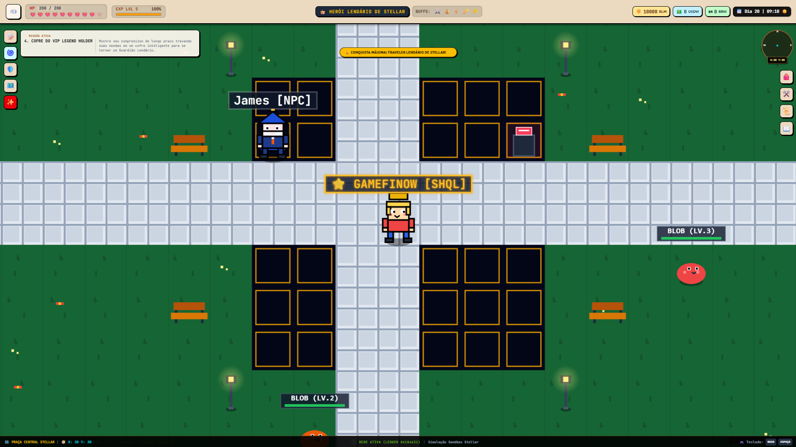
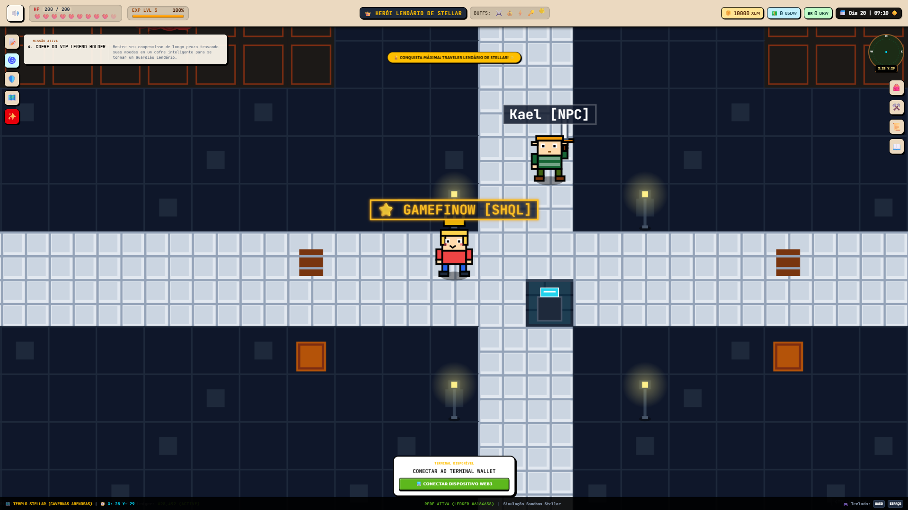
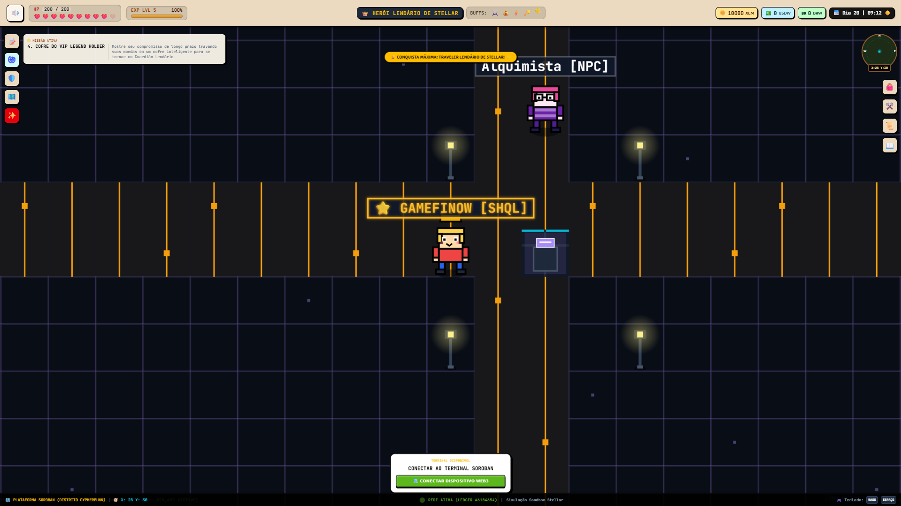
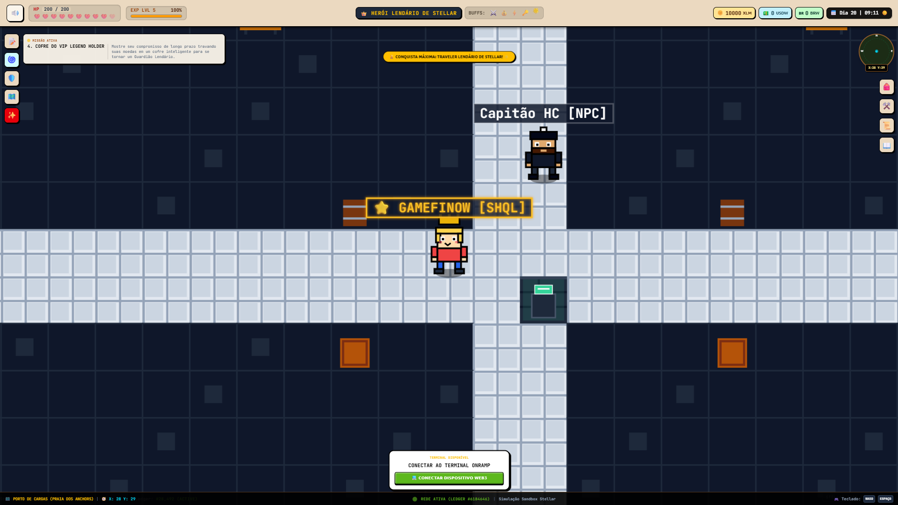
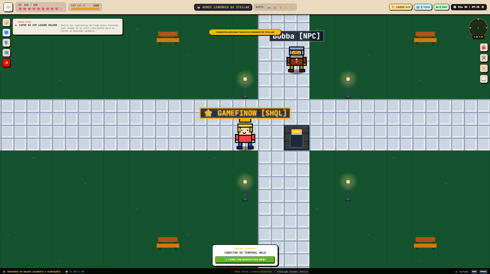
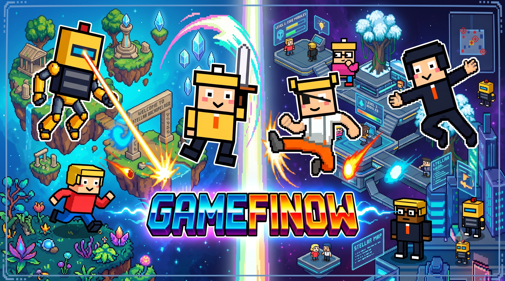

<div align="center">
  <a href="https://github.com/nsdBRoficial/gamefinow_game">
    
  </a>
<div align="center">
  <a href="https://github.com/nsdBRoficial/gamefinow_game">
    
  </a>
  <h1 align="center">GameFiNow — v1.5pvp</h1>
  <p align="center"><strong>The Definitive Arena & Open-World PvP Update — A Gamified On-Boarding & DeFi MMO RPG for the Stellar Ecosystem</strong></p>
  <p align="center">
    
    
    
    
    
    
    
  </p>
</div>

---

## 🌟 About the Project

**GameFiNow** is a retro-style MMO RPG built on Web3, designed to educate and onboard new users into the Stellar network in an intuitive, fun, and engaging way. Players complete interactive quests that simulate real on-chain interactions — from generating a cryptographic keypair, to depositing funds via an Anchor (On-Ramp), to swapping tokens using Soroban smart contracts and locking assets in a hold vault.

The game runs entirely in the browser, using a 60 FPS HTML5 Canvas engine, and communicates with the **Stellar Testnet** via **WalletNow SDK** and the **Horizon API**.

---

## ⚔️ What's New in v1.5pvp — Open-World Arena PvP & Realtime Combat Engine

Esta versão histórica (**v1.5pvp**) introduz o ecossistema completo de combate entre jogadores em tempo real (PvP) no mapa aberto do Coliseu, unificando a infraestrutura de rede, HUDs de combate, equilíbrio de classes e protocolos anti-cheat.

### 🏟️ 1. O Coliseu de Batalhas (Mapa Arena 60×60)
- **Ringue Aberto de Combate**: Mapa dedicado com piso de areia central (raio de 14 tiles), tochas ornamentais, muralhas de pedra e arquibancadas de observação.
- **Portais de Saída Estratégicos**: Zona de retirada protegida ao sul (x=30, y=55) para retorno imediato à cidade central.
- **Entrada Direta via Cidade Central**: Edifício da Arena e portal interativo localizado na praça norte do mapa central (`x=41, y=17`).

### 🎯 2. Target Locking & Target HUD
- **Seleção Dinâmica de Alvo**: Clique direto em qualquer jogador ou monstro para travar a mira (`lockedTargetId`).
- **Target HUD Completo**:
  - Exibição de avatar/ícone de combate (`⚔️` para jogadores, `👾` para monstros).
  - Nome completo e Tag de Guilda (ex: `[STAR] LordStellar`).
  - Nível do adversário (`Lv. X`) com badge estilizada.
  - Barra de Vida (HP) em gradiente reativo com valor numérico exato em tempo real.
  - Tecla de atalho `ESC` para desengajar e limpar o alvo.

### 🏆 3. Arena Scoreboard HUD (Placar em Tempo Real)
- Painel flutuante de alta fidelidade visual (Cyberpunk Dark Mode) exibido enquanto o jogador estiver na Arena:
  - **Abates (Kills)**: Contador cumulativo de vitórias no combate.
  - **Mortes (Deaths)**: Monitoramento de derrotas.
  - **K/D Ratio**: Cálculo dinâmico de eficiência de combate.
  - **Streak & Recorde**: Indicador de sequências de abates (com animação de chamas `🔥` a partir de 3 kills seguidas) e maior sequência registrada.
  - **Reset Contextual**: Limpeza limpa da sessão ao sair da Arena.

### 🛡️ 4. Contextual Respawn & Safe Spawn Anti-Combat Logging
- **Renascer Contextual na Arena**: Ao ser abatido no Coliseu, o jogador renasce na base sul da Arena (`x=30, y=53`), sem precisar retornar à cidade central.
- **Escudo de Proteção Anti-Spawn Kill**: Concede 3 segundos de invulnerabilidade (`buff_shield_respawn`) logo após o respawn, impedindo mortes consecutivas.
- **Safe Spawn Garantido**: Jogadores que desconectam, fecham a aba ou recarregam o jogo enquanto estão na Arena são posicionados de volta no centro pacífico (`x=30, y=30`), prevenindo *combat logging* e armadilhas de morte.

### ⚡ 5. Sincronização Multiplayer Realtime (Socket.io + Supabase)
- **Isolamento Multi-Aba**: Função `getOrCreatePlayerId()` isola identificadores anônimos por aba (`sessionStorage` e `window.name`), permitindo testar batalhas locais entre múltiplas abas no mesmo navegador sem colisões.
- **Transmissão Contínua de Presença**: Sincronização mutua de sprites, skins, chapéus, cores, direções e heartbeats ativos.
- **Reconciliação e Desconexão Limpa**: Remoção instantânea de fantasmas e eventos de limpeza ao fechar o navegador.

### ⚖️ 6. Motor de Combate (PvP Engine) e Balanceamento
- **Alcances por Classe (Attack Ranges)**:
  - *Guerreiro Estelar & Guardião da Rede*: Melee (1.5 tiles).
  - *Caçador Cósmico*: Ranged Físico (4.5 tiles).
  - *Alquimista Soroban*: Ranged Mágico (4.5 tiles).
- **Global Cooldown (GCD)**: Barramento de ações dinâmico com indicador regressivo na barra de magias (Heal 800ms, Fire 1500ms, Lightning 2500ms).
- **Cooldown de Poções**: GCD compartilhado de 1.0s com cooldown próprio de 5.0s.
- **Fórmulas de Dano & Anti-Cheat**: Teto máximo de dano por nível validado no servidor para neutralizar clientes adulterados.

---

## 🏰 What's New in v0.8.8 — Guild House System & Class Consecration

### ⚔️ Sistema de Consagração de Classes (Class Consecration)
- **4 Classes Disponíveis** com atributos e passivas únicas:
  | Classe | Ícone | Role | Passiva |
  |--------|-------|------|---------|
  | **Guerreiro Estelar** | ⚔️ | Melee / Tanker | Pele de Aço: -15% dano físico recebido, +25% HP base |
  | **Alquimista Soroban** | 🧙 | Caster / AoE Magic | Sobrecarga Arcana: Crits restauram 20% MP e +20% dano mágico |
  | **Caçador Cósmico** | 🏹 | Ranged / Crítico | Passo Ligeiro: +15% velocidade e +12% de esquiva |
  | **Guardião da Rede** | 🛡️ | Paladino / Suporte | Aura Sagrada: +3 HP/s regeneração contínua |

- **Desbloqueio**: Após concluir a **1ª Quest** (1 Estrela), a Fonte de Classes é ativada no mapa.
- **Troca de Classe**: Custa **10 tokens GAMEFI** para mudar de classe após a escolha inicial.
- **Modificadores de Stats** por classe: STR, INT, AGI, RES e FAITH individuais.
- **Interface**: Modal `ClassSelectionModal` acessível via HUD mostrando magias por classe.

### 🏰 Sistema de Guildas (Guild House System)
- **Criação de Guilda**: Custa **50 tokens GAMEFI**. Cada guilda tem nome, tag (ex: `[STAR]`, `[XLM]`), ícone e cor personalizados.
- **Hierarquia**: Roles `Leader`, `Officer` e `Member` com permissões diferenciadas.
- **Tesouro da Guilda**: Saldo compartilhado em GAMEFI para despesas coletivas.
- **Teleport para Guildhouse**: Botão dedicado que transporta o líder diretamente para a Guildhouse.
- **Persistência Local**: Dados de guildas salvos em `localStorage` com estrutura `Guild` tipada.
- **Tag no Personagem**: Membros exibem a tag da guilda acima do nome no mapa 2D.

### 🌐 Documentação e About Page Atualizados
- Seção **Economy** do About expandida com cards de **Guild System** e **Class Consecration**.
- **Roadmap** atualizado com fases reais e planejadas (Genesis ✅ → Expansion 🔥 → Economy ⏳ → Multiverse 🌌).
- Versão `v0.8.8` propagada em todas as interfaces: README, sidebar, Hero badge, footer.
- Correção de **encoding quebrado** nos arquivos de tradução PT e ES (caracteres especiais restaurados).

---

## 🛡️ What's New in v0.8.2 — Full Audit, GM Character System & Relayer Anti-Bypass

### 🔴 Personagem GM (Game Master) Dedicado
- **Isolamento de Acesso**: Entrada via `/admin` separada da autenticação de jogadores comuns.
- **Visual GM Único**: Tag vermelha `⭐ [GM]`, contorno visual especial, LVL 99, status máximos (9999 HP/FOR/INT/AGI/RES).

### 🔒 Backend Fee Relayer (`/api/relayer/submit`)
- **Validação Atômica da Taxa**: Verificação executada no servidor Express antes da submissão à Horizon Testnet, prevenindo bypass da taxa de 0.5% XLM.

### 📜 Auditoria Completa
- Documento `DOC_AUDITORIA_E_AVALIACAO.md` com matriz completa de integrações **On-Chain**, **Híbridas/Simuladas**, **Backend Off-Chain** e **Painel Admin GM**.

---

## ✨ What's New in v0.7.9.5 — Game Master Command Center & Player Moderation

### 🛡️ Centro de Comando GM
- **Painel Administrativo** secreto em `/admin` com autenticação JWT.
- **Relatórios de Jogadores ao Vivo**: Lista todos os jogadores online com ID da carteira e ações de moderação.

### 🔨 Sistema de Banimento & Suspensão em Tempo Real
- **Moderação via WebSockets**: Integração Supabase + Socket.io.
- **Punições Escalonadas**: Advertências, suspensões temporárias (1/3/7 dias) e banimento permanente.
- **Enforcer RLS**: Row Level Security protege campos `is_banned` e `suspended_until`.

---

## ✨ What's New in v0.7.7 — Real XLM Outfits & On-Chain Rename

### 👗 On-Chain XLM Outfit Purchases
- **10 outfits pixel art** premium com transações reais em XLM para o treasury wallet.
- **Silhueta feminina**: Sprites com curva 16px ombro → 14px cintura → 16px quadril.

### 💳 On-Chain Character Rename (5 XLM)
- **Nome custa 5 XLM** pagos diretamente ao treasury GameFi com hash de transação no Stellar Expert.

### 🎨 5-Tier Quest Name Tag Colors
- Tags de nome coloridas automaticamente com progresso das quests:
  1. **Náufrago** (0 quests): Branco
  2. **Iniciado** (Quest 1): Amarelo `#ffc600`
  3. **Operador** (Quest 2): Noble Gold `#fbbf24`
  4. **Alquimista** (Quest 3): Mystic Purple `#e879f9`
  5. **Herói Lendário** (Quest 4): Matrix Green `#00ff66` ✨

---

## 🗺️ The 4-Quest Onboarding Journey

| # | Quest | Zone | NPC | Blockchain Concept |
|---|-------|------|-----|---------------------|
| 1 | **Forge Your Identity** | East (Blue Bridge) | Kael [NPC] | Cryptographic Keypair |
| 2 | **Acquire Realm Coins** | North (Green Portal) | Captain HC [NPC] | Anchor / On-Ramp |
| 3 | **Trade on the Catalog** | West (Purple Portal) | Alchemist [NPC] | Soroban Smart Contracts |
| 4 | **VIP Legend Vault** | South (Golden Portal) | Elder Bobba [NPC] | Escrow / Hold |

---

## ⚔️ Classes & Guild System

### Classes (Consagração na Fonte — Quest 1 necessária)

| ID | Nome | Role | STR | INT | AGI | RES | FAITH |
|----|------|------|-----|-----|-----|-----|-------|
| `warrior` | Guerreiro Estelar | Melee Tanker | +60% | -20% | +10% | +40% | Base |
| `soroban_mage` | Alquimista Soroban | Caster AoE | -20% | +80% | +10% | -20% | +30% |
| `cosmic_ranger` | Caçador Cósmico | Ranged DPS | +30% | Base | +70% | -10% | Base |
| `network_guardian` | Guardião da Rede | Paladino Suporte | +20% | +10% | -10% | +50% | +60% |

### Guildas

| Recurso | Detalhes |
|---------|----------|
| **Custo de Criação** | 50 GAMEFI tokens |
| **Tag** | 2–5 caracteres ex: `[XLM]`, `[STAR]` |
| **Roles** | Leader / Officer / Member |
| **Tesouro** | Saldo compartilhado em GAMEFI |
| **Teleport** | Acesso direto à Guildhouse no mapa |

---

## 🗺️ World Map & Biomes Gallery

<div align="center">
  <table>
    <tr>
      <td align="center" width="33%">
        <br/>
        <b>🏛️ Praça Central (Hub & Stands)</b>
      </td>
      <td align="center" width="33%">
        <br/>
        <b>🌅 Bioma Leste (Arsenal & Wallet Forge)</b>
      </td>
      <td align="center" width="33%">
        <br/>
        <b>🌊 Bioma Oeste (Mercado Soroban)</b>
      </td>
    </tr>
    <tr>
      <td align="center" width="33%">
        <br/>
        <b>🏔️ Bioma Norte (Porto Nearx & On-Ramp)</b>
      </td>
      <td align="center" width="33%">
        <br/>
        <b>🌴 Bioma Sul (Santuário DefIndex & Hold)</b>
      </td>
      <td align="center" width="33%">
        <br/>
        <b>🎮 GameFiNow Universe</b>
      </td>
    </tr>
  </table>
</div>

---

## 🌐 Full Internationalization (i18n)

- **3 idiomas suportados**: English (EN), Português BR (PT), Español (ES)
- Powered by `react-i18next` com arquivos de locale em `src/i18n/locales/`
- Todos os textos de UI, HUD, NPCs, diálogos de quests, barreiras e novas seções (Guild + Classe) são totalmente localizados

---

## 🕹️ Tech Stack

| Technology | Role |
|------------|------|
| **React 19 + TypeScript** | UI components and HUD |
| **Vite 6** | Fast bundler for dev & production |
| **HTML5 Canvas API** | 60 FPS game engine with retro tilemaps |
| **Tailwind CSS v4** | Styling, glassmorphism, animations |
| **Zustand** | Global state management (inventory, quests, wallet, guild) |
| **react-i18next** | Multilingual support (EN / PT / ES) |
| **WalletNow SDK** | On-Ramp, Vault, Swap integrations |
| **Stellar Horizon API** | Testnet balance fetching & transactions |
| **NippleJS** | Mobile joystick controls |
| **Socket.io** | Real-time multiplayer & GM moderation |
| **Supabase** | Player persistence, RLS, ban system |
| **Express.js** | Backend relayer with fee validation |
| **@google/genai** | Generative AI integration |

---

## 🚀 Running Locally

**Prerequisites:** Node.js v18+

```bash
# Install dependencies
npm install

# Start frontend dev server
npm run dev
# → http://localhost:3000

# Start backend relayer (separate terminal)
npm run backend
# → http://localhost:3001

# Type check (zero-error guarantee)
npm run lint

# Run tests
npx vitest run

# Production build
npm run build
```

---

## 📁 Project Structure

```
src/
├── App.tsx                     # Main app router & game loop orchestrator
├── gameData.ts                 # Tile types, NPC definitions, quest config
├── classesData.ts              # 4 RPG classes with stat modifiers & passives
├── guildsData.ts               # Guild system: creation, join, persistence
├── spellsData.ts               # Class spells with cooldowns and MP costs
├── equipmentData.ts            # Equipment items and stats
├── types.ts                    # TypeScript interfaces (Quest, NPC, WalletState, Guild...)
├── components/
│   ├── AboutPage.tsx           # Public about/docs page with Live Stellar stats
│   ├── LandingPage.tsx         # Marketing landing page
│   ├── LoginScreen.tsx         # Animated login / character creation
│   ├── GameCanvas.tsx          # 60 FPS canvas engine & player controller
│   ├── GameOverlay.tsx         # Quest modals (Wallet, OnRamp, Soroban, Hold)
│   ├── DialogSystem.tsx        # NPC dialogue pop-up system
│   ├── FloatingWindows.tsx     # Inventory, wardrobe, ledger, rulebook
│   ├── ClassSelectionModal.tsx # Class consecration at the Fountain (4 classes)
│   ├── GuildModal.tsx          # Guild creation, exploration and management
│   ├── BattleHUD.tsx           # Real-time combat HUD with spells
│   ├── AdminPanel.tsx          # GM Command Center at /admin
│   ├── CharacterCustomizer.tsx # Pixel art outfit customizer
│   ├── MapModal.tsx            # Full-screen world map viewer
│   ├── PassportModal.tsx       # Player passport / ID card
│   ├── DeathScreenModal.tsx    # Death screen with respawn
│   ├── ChatBox.tsx             # Real-time multiplayer chat
│   ├── Level5IntroModal.tsx    # Tutorial modal at Level 5 unlock
│   ├── WelcomeTutorialModal.tsx# First-time onboarding tutorial
│   └── canvas/                 # Canvas sub-components (sprites, rendering)
├── i18n/
│   ├── i18n.ts                 # i18next configuration
│   └── locales/
│       ├── en.json             # English strings (default)
│       ├── pt.json             # Portuguese strings (PT-BR)
│       └── es.json             # Spanish strings (ES)
├── maps/                       # Map tile definitions (center, east, west, north, south)
├── services/
│   ├── stellarServices.ts      # WalletNow SDK & Horizon API integrations
│   ├── multiplayerService.ts   # Socket.io real-time multiplayer
│   └── sep24Service.ts         # SEP-24 anchor deposit flow
├── store/
│   └── gameStore.ts            # Zustand global state store
└── docs/
    └── PrivacyPolicy.md        # Privacy policy document
```

---

## ☁️ Deploying to Vercel

Zero-config deployment. The Canvas engine is iframe-resistant (custom `tabIndex` and `window.focus()` handling ensures WASD/Arrow keys work inside Vercel's sandbox):

1. Connect your repo to [vercel.com](https://vercel.com)
2. Framework preset: **Vite**
3. Build command: `npm run build`
4. Output directory: `dist`

---

## 📖 Additional Documentation

| Document | Description |
|----------|-------------|
| [`DOC_SISTEMA_PVP_ARENA_V1_5.md`](./DOC_SISTEMA_PVP_ARENA_V1_5.md) | **Especificação Completa do Sistema PvP Arena v1.5pvp (Arquitetura, Rede & Combate)** |
| [`GUIA_DEPLOY_VERCEL.md`](./GUIA_DEPLOY_VERCEL.md) | Guia e checklist de deploy na Vercel (Variáveis, SPA Rewrites e Webhook) |
| [`ROADMAP.md`](./ROADMAP.md) | Feature roadmap by phase |
| [`DOC_AUDITORIA_E_AVALIACAO.md`](./DOC_AUDITORIA_E_AVALIACAO.md) | On-chain integration audit matrix |
| [`DOC_MULTIPLAYER_MMO.md`](./DOC_MULTIPLAYER_MMO.md) | Multiplayer architecture & Socket.io |
| [`DOC_ECONOMIA_TOKENOMICS.md`](./DOC_ECONOMIA_TOKENOMICS.md) | GAMEFI tokenomics & fee model |
| [`DOC_ESTRATEGIA_BATALHAS.md`](./DOC_ESTRATEGIA_BATALHAS.md) | Battle system strategy |
| [`DOC_EVOLUCAO_E_DROPS.md`](./DOC_EVOLUCAO_E_DROPS.md) | XP scaling & monster drop tables |

---

<div align="center">
  <b>Built with passion by nsdBR GameFiNow Team</b><br/>
  <sub>v1.5pvp — Stellar Testnet — October 2026</sub>
</div>
